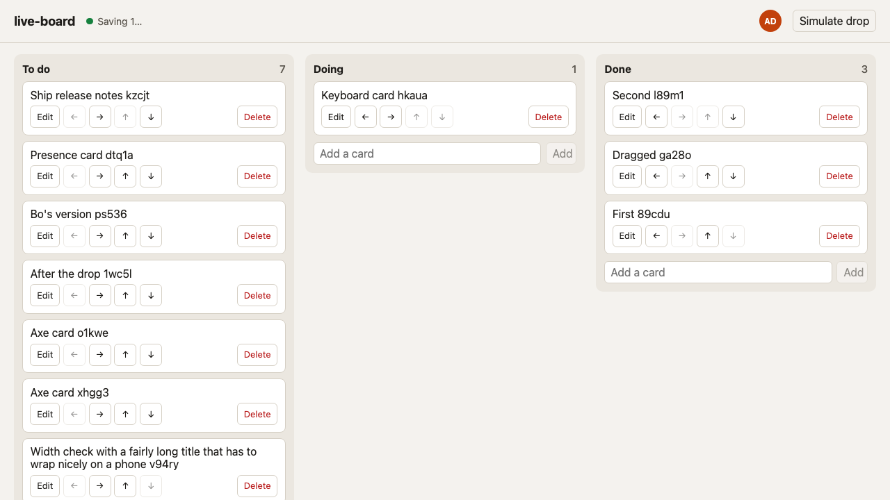

# live-board

A real-time kanban board for a small team: several people edit the same board over
WebSockets, every change shows up instantly for the person who made it (optimistic
update), everyone else sees it a moment later, and the board stays consistent when
two people touch the same card at the same time or someone's connection drops.



**Stack:** TypeScript end to end · React 19 + Vite · Node 24 `http` + [`ws`](https://github.com/websockets/ws) ·
`node:sqlite` · zod · Vitest + fast-check · Playwright + axe-core · GitHub Actions.
The server runs straight from `.ts` files with Node's built-in type stripping (no build step).

## Try it

```bash
npm install
npm run dev          # board server on :8790 + Vite on :5196 (proxies /ws)
```

Open http://localhost:5196 in two tabs or two browsers. Each tab is a separate person.
**Simulate drop** closes the socket so you can watch it reconnect and catch up.

Production-style: `npm run build && npm start` serves the built UI and the socket on `:8790`
(`PORT`, `HOST`, `DB_PATH` are configurable; `DB_PATH=:memory:` for a throwaway board).

## How it works

```
 browser A                         server                          browser B
 ─────────                         ──────                          ─────────
 submit(op) ─► view updates now
           ──── {op, clientOpId} ─► validate (zod) → apply → seq 42
                                    write op + card (one SQLite tx)
           ◄──────────── {op, seq 42} ──────────────────────────────► apply
 drop from pending
```

- **The server defines one order.** Every op from every connection goes through one
  `Room` and gets the next `seq`. Clients never merge with each other; they follow the
  server's stream. Moves are last-writer-wins in that order (cheap to redo).
- **Optimistic updates with rebase.** The client keeps `confirmed` (the board at the last
  seq it has) and `pending` (its own unanswered ops). What you see is `pending` replayed
  on top of `confirmed`. When someone else's op arrives, it goes into `confirmed` and your
  pending ops are replayed again on top. This is the same model Replicache uses; it lives
  in [`src/client/sync-state.ts`](src/client/sync-state.ts) as pure functions.
- **Renames are compare-and-set.** A rename carries the title you saw when you started
  editing. If someone else saved first, the server rejects yours and the UI tells you what
  their title was and what yours was, instead of one of you silently losing text.
- **Delete wins.** Any op on a deleted card is rejected; a pending move on it just
  disappears from your view.
- **Fractional ranks.** A card's position is a base-62 string that sorts between its
  neighbours ([`src/shared/rank.ts`](src/shared/rank.ts)), so a move rewrites one row. If two
  people drop a card into the same gap at the same moment, the server nudges the second
  one just after the first so every client shows the same order.
- **Reconnect and idempotency.** On every (re)connect the client says `hello` with the
  last seq it has. The server replies with just the ops it missed, or a full snapshot if it
  is more than 500 behind (or ahead, after a server reset). Pending ops are then resent;
  the server dedupes on `clientOpId` (a UNIQUE column in the op log), so an op whose ack
  was lost is never applied twice.
- **Presence** (who is online, who is editing or dragging which card) is in memory only,
  coalesced into at most one broadcast per 50 ms, and dropped when a socket closes. A
  protocol-level ping every 15 s removes sockets whose peer vanished without closing.
- **Abuse limits.** 16 KB max frame, zod validation of every message, a per-connection
  token bucket (30 msg/s, burst 60; flooding closes the socket with 1008), 200-char
  titles, 500 cards.
- **Accessibility.** Cards are focusable and move with Alt+Arrow keys (focus follows the
  card); every move also has a button, which is how phones move cards since HTML5 drag
  and drop has no touch support. Conflict messages are announced via `role="alert"`.

## How it was tested

| Suite | What | Count |
|---|---|---|
| `test/rank.test.ts` | fast-check properties: result strictly between, always valid, 200 random inserts stay sorted; 3,000 appends/prepends stay under the length cap | 7 |
| `test/board.test.ts` | apply rules (CAS rename, delete wins, validation, cap), ordering, zod schema rejects hostile messages | 11 |
| `test/sync-state.test.ts` | optimistic view, rebase over remote ops, reject → notice, gap → resync, catch-up + resend | 9 |
| `test/room.test.ts` | server ordering, dedupe, reject to sender only, rank collision, catch-up vs snapshot, rate limit, presence coalescing, restart from the same SQLite file | 10 |
| `test/integration.test.ts` | real server + real sockets + `SyncClient`: presence, offline ops sent once, lost ack, server reset, and a **chaos property**: 3 clients, 120 random ops with random disconnects, 8 seeds, all three views must equal the server's board | 5 |
| `e2e/board.spec.ts` | Playwright, two browser contexts as two people, desktop Chrome + Pixel 7: sync, Alt+Arrow move, reorder, presence, concurrent rename conflict, simulated drop, drag and drop, axe WCAG 2.1 AA in light and dark, no sideways page scroll on phones | 19 (+1 skipped: drag on phone) |

`npm test` runs the first 42; `npm run test:e2e` builds the UI and runs Playwright against the
production server with an in-memory database.

**Mutation check:** 13 deliberate bugs (e.g. remove the dedupe, drop the rename CAS, don't
clear pending on commit, skip the resend after reconnect, don't resolve rank collisions,
don't refocus after a keyboard move) were each caught by at least one test, then reverted.
Two real bugs were found while writing the tests: ranks appended at the end of a column
grew about 5x faster than intended (fixed with single-digit steps), and visually hidden
labels widened the page on phones.

## Honest limits

- **One board, no auth.** Names are self-chosen and stored in `localStorage`; anyone who can
  reach the server can edit. Real use needs sign-in and per-board permissions.
- **One server process.** The ordering guarantee comes from a single in-process `Room`.
  More than one instance would need a shared sequencer (Postgres row lock, Redis stream,
  or sticky routing per board).
- **Pending ops live in memory.** Closing the tab while offline loses unsent changes; this
  is not an offline-first app (that is a different project: care-log).
- **Columns are fixed** (To do / Doing / Done), and cards have only a title.
- **Ranks are never rebalanced.** A column can take roughly 4,000 consecutive appends at
  one end before a rank hits the 128-char cap; after that the server rejects the move.
- **No load testing.** Concurrency was tested with 3 simulated clients and 2 browsers, not
  hundreds of sockets.
- Tested in Chromium only (desktop and Pixel 7 emulation), not on real phones, Safari or
  Firefox, and not with a screen reader.

## Layout

```
src/shared/    board model, applyOp, ranks, wire protocol (runs on both sides)
src/client/    sync-state.ts (pure rebase logic), sync-client.ts (socket, reconnect, ping)
src/ui/        React components
server/        room.ts (ordering, dedupe, presence), store.ts (SQLite), server.ts (http + ws)
test/          Vitest suites       e2e/   Playwright
```

MIT licensed.
